# Model guide

This guide shows how to build, read, edit, validate, and convert passports with `dpp_sdk.core` and
`dpp_sdk.dpp4fun`. The code blocks build on each other and run in order.

Related pages:

- [DPP4Fun field reference](dpp4fun-fields.md): every field name you can pass to the typed classes.
- [HTTP clients guide](clients-guide.md): sending passports to a repository and registry.
- [Building your own profile](extending.md): using Core without DPP4Fun.
- [Standards alignment and validation rules](conformance.md): clause mapping, source conflicts,
  and the full rule tables.

## Overview



A `DigitalProductPassport` has one `DppHeader` and an ordered tuple of DataElements. Collections and
multi-valued elements can contain further elements.

```text
DigitalProductPassport
├── DppHeader (required at construction)
└── data_elements: tuple[DataElement, ...]
    ├── DataElementCollection → elements: tuple[DataElement, ...]
    ├── SingleValuedDataElement → value: JSON value
    ├── MultiValuedDataElement → value: tuple[DataElement, ...]
    ├── MultiLanguageDataElement → value: tuple[MultiLanguageValue, ...]
    └── RelatedResource → URL and descriptive metadata
```

| Element | Holds |
| --- | --- |
| `DataElementCollection` | Ordered nested elements. |
| `SingleValuedDataElement` | One JSON value (scalar, object, array, or null) and an optional `value_data_type` such as `xsd:string`. |
| `MultiValuedDataElement` | An ordered tuple of child DataElements and an optional common datatype. |
| `MultiLanguageDataElement` | Ordered `MultiLanguageValue(value=..., language=...)` entries. |
| `RelatedResource` | Link metadata: content type, URL, language, and title. |

All models are immutable (frozen Pydantic models, tuples instead of lists). Edits return a new copy.
Python attributes are `snake_case`; JSON keys keep their camelCase names (`dpp_header.dpp_status`
becomes `"dppStatus"`).

`dpp_sdk.dpp4fun` is a typed view over a core passport for the DPP4Fun furniture profile. You can
always get the core passport back with `as_digital_product_passport()`.

## Build a core passport

Use core directly when you are not working with the DPP4Fun profile:

```python
from datetime import UTC, datetime

from dpp_sdk.core import (
    DataElementCollection,
    DigitalProductPassport,
    DppHeader,
    Granularity,
    MultiLanguageDataElement,
    MultiLanguageValue,
    SingleValuedDataElement,
)

header = DppHeader(
    digital_product_passport_id="urn:example:dpp:chair-1",
    unique_product_identifier="urn:example:product:chair-1",
    granularity=Granularity.ITEM,
    dpp_schema_version="1.0",
    dpp_status="active",
    last_updated=datetime(2026, 1, 1, tzinfo=UTC),
    economic_operator_id="urn:example:operator:example-furniture",
)
core_passport = DigitalProductPassport(
    dpp_header=header,
    data_elements=(
        DataElementCollection(
            element_id="nameplate",
            elements=(
                SingleValuedDataElement(
                    element_id="manufacturerName",
                    value="Example Furniture",
                    value_data_type="xsd:string",
                ),
                MultiLanguageDataElement(
                    element_id="productDescription",
                    value=(MultiLanguageValue(value="Chair", language="en"),),
                ),
            ),
        ),
    ),
)
```

All header fields are optional at construction, so you can hold and inspect an incomplete passport.
Validation and JSON output need these seven: `digital_product_passport_id`,
`unique_product_identifier`, `granularity` (`MODEL`, `BATCH`, or `ITEM`), `dpp_schema_version`,
`dpp_status`, `last_updated` (timezone-aware), and `economic_operator_id`. `facility_id` and
`content_specification_ids` are optional.

## Build a DPP4Fun passport

`Dpp4Fun.create()` takes a header plus any number of aspects and at most one product type
(Characteristics variant). Each aspect class has a `create(**fields)` method:

```python
from dpp_sdk.dpp4fun import (
    BillOfMaterials,
    ChairCharacteristics,
    Dpp4Fun,
    Dpp4FunQuantity,
    LengthUnit,
    Material,
    Nameplate,
)

passport = Dpp4Fun.create(
    header,
    Nameplate.create(manufacturerName="Example Furniture", gtinCode="04012345678901"),
    BillOfMaterials.create(
        materialSet=(
            Material.create(name="Oak", portion=0.75).element,
            Material.create(name="Steel", portion=0.25).element,
        )
    ),
    ChairCharacteristics.create(color="blue").with_quantity(
        "height", Dpp4FunQuantity(value=80.0, unit=LengthUnit.CENTIMETER)
    ),
)
```

Things to know:

- **Field names** are the camelCase element IDs from the profile (`manufacturerName`, not
  `manufacturer_name`). The [field reference](dpp4fun-fields.md) lists all of them per aspect. An
  unknown name raises `KeyError`.
- **Repeated items** (paths with `[*]` in the field reference) are built with a composite class such
  as `Material`, `Component`, `Certificate`, or `RepairRecord`. Pass their `.element` values as a
  tuple. The SDK assigns item IDs (`material_00`, `material_01`, …) in input order.
- **Quantities** pair a number with a unit. `Dpp4FunQuantity` accepts `LengthUnit`, `MassUnit`, or
  `VolumeUnit`; a unit of the wrong dimension is rejected. `with_quantity()` also fills the matching
  unit field (`heightUnit` above).
- **Unknown elements** that fit a core DataElement shape are kept, not dropped, when you read or
  edit a passport.

## Read fields

```python
nameplate = passport.typed_aspect(Nameplate)  # None if the passport has no nameplate
assert nameplate is not None
assert nameplate.field("manufacturerName").value == "Example Furniture"

chair = passport.selected_characteristics()  # the product type, or None
assert isinstance(chair, ChairCharacteristics)
height = chair.quantity("height")
assert height is not None and height.value == 80.0 and height.unit is LengthUnit.CENTIMETER

bill = passport.typed_aspect(BillOfMaterials)
assert bill is not None
materials = bill.field("materialSet").value  # tuple of DataElementCollections
assert [Material.from_element(item).field("name").value for item in materials] == ["Oak", "Steel"]

assert passport.header.digital_product_passport_id == "urn:example:dpp:chair-1"
```

- `typed_aspect(AspectClass)` returns the typed aspect or `None`.
- `field(name)` returns the core DataElement (read `.value`) or `None` when the field is not set.
- `quantity(name)` returns a `Dpp4FunQuantity` or `None`.
- `get_aspect("nameplate")` returns the raw `DataElementCollection` by element ID.
- `Dpp4Fun.from_passport(core_passport)` wraps any core passport, for example one you decoded with
  the core codec.

## Edit

Every edit returns a new object; the original stays unchanged.

```python
renamed = nameplate.with_field("manufacturerName", "Example Furniture GmbH")
updated = passport.with_updates(aspects=(renamed,))  # replaces the nameplate, keeps the rest
assert updated.typed_aspect(Nameplate).field("manufacturerName").value == "Example Furniture GmbH"
assert passport.typed_aspect(Nameplate).field("manufacturerName").value == "Example Furniture"

retired = core_passport.with_updates(
    dpp_header=core_passport.dpp_header.with_updates(dpp_status="inactive")
)
assert retired.dpp_header.dpp_status == "inactive"
```

`with_updates()` and `with_field()` check structure (types, element shapes, profile bindings) but
do not run the semantic rules. Validate explicitly before you send a passport anywhere.

## Validate

Validation is a separate step. It never changes the passport and never raises for findings; it
returns an ordered report.

```python
from dpp_sdk import validate_dpp4fun
from dpp_sdk.core import DppValidator, ValidationStatus

report = validate_dpp4fun(updated)
assert report.is_valid

empty = DppValidator().validate(DigitalProductPassport(dpp_header=DppHeader()))
assert empty.status is ValidationStatus.INVALID
first = empty.issues[0]
assert first.path == "header.digitalProductPassportId"
assert first.rule == "EN18223_HEADER_DPP_ID_REQUIRED"
```

| Validator | Checks |
| --- | --- |
| `DppValidator` | Required header fields, element IDs and cardinality, kind/datatype consistency, nested structure. |
| `DataFormatValidator` | JSON value types, language and URI syntax, list structure. |
| `IdentifierValidator` | Identifier syntax for an identifier method you choose (GS1 Digital Link, GS1 GLN, Identification Link). Only local syntax: no issuance, uniqueness, or resolution. |
| `validate_dpp4fun()` | All of the above (identifiers only when you pass an `IdentifierValidationContext`), then the DPP4Fun D4.1 profile rules. |

Each `ValidationIssue` has `path`, `rule`, `message`, and `severity` (`ERROR` or `WARNING`).
`ValidationResult.status` is `VALID` when there are no errors, `UNSUPPORTED` when the only errors
come from unsupported identifier methods, and `INVALID` otherwise; `is_valid` reflects it. Paths
look like `header.<jsonField>`, `elements.<aspect>.<field>`, or
`elements.<aspect>.<list>[index]` for repeated items.

To check identifiers too, say which method each identifier uses; the SDK never guesses it:

```python
from dpp_sdk.core import (
    EconomicOperatorIdentifierMethod,
    IdentifierValidationContext,
    ProductIdentifierMethod,
)

context = IdentifierValidationContext(
    product_identifier_method=ProductIdentifierMethod.GS1_DIGITAL_LINK,
    economic_operator_identifier_method=EconomicOperatorIdentifierMethod.GS1_GLN,
)
identifier_report = validate_dpp4fun(updated, context)
assert not identifier_report.is_valid  # the urn:example identifiers are not GS1 identifiers
```

The full rule list, with rule codes and the source each rule comes from, is in
[conformance.md](conformance.md#core-rules).

## Convert to and from JSON

There are two JSON forms:

- **FULL** (also called expanded) carries every element's `objectType`, datatype, and dictionary
  reference. It can always be read back without extra information.
- **COMPRESSED** keeps only values, keyed by element ID. It is shorter, but reading it back needs
  the metadata from somewhere: the DPP4Fun profile, a previous version of the passport, or your own
  [semantic resolver](extending.md).

The core passport above in FULL form (header fields sit at the root next to `elements`):

```json
{
  "digitalProductPassportId": "urn:example:dpp:chair-1",
  "uniqueProductIdentifier": "urn:example:product:chair-1",
  "granularity": "item",
  "dppSchemaVersion": "1.0",
  "dppStatus": "active",
  "lastUpdated": "2026-01-01T00:00:00Z",
  "economicOperatorId": "urn:example:operator:example-furniture",
  "contentSpecificationIds": [],
  "elements": [
    {
      "elementId": "nameplate",
      "objectType": "DataElementCollection",
      "elements": [
        {
          "elementId": "manufacturerName",
          "objectType": "SingleValuedDataElement",
          "value": "Example Furniture",
          "valueDataType": "xsd:string"
        },
        {
          "elementId": "productDescription",
          "objectType": "MultiLanguageDataElement",
          "value": [{"value": "Chair", "language": "en"}]
        }
      ]
    }
  ]
}
```

The same passport in COMPRESSED form:

```json
{
  "digitalProductPassportId": "urn:example:dpp:chair-1",
  "uniqueProductIdentifier": "urn:example:product:chair-1",
  "granularity": "item",
  "dppSchemaVersion": "1.0",
  "dppStatus": "active",
  "lastUpdated": "2026-01-01T00:00:00Z",
  "economicOperatorId": "urn:example:operator:example-furniture",
  "contentSpecificationIds": [],
  "nameplate": {
    "manufacturerName": "Example Furniture",
    "productDescription": [{"value": "Chair", "language": "en"}]
  }
}
```

Use `Dpp4FunJsonCodec` for DPP4Fun passports and `DppJsonCodec` for core passports. The two codecs
name some methods differently:

| Task | `Dpp4FunJsonCodec` | `DppJsonCodec` (core) |
| --- | --- | --- |
| Write FULL | `to_json()` or `to_expanded_json()` | `to_expanded_json()` |
| Read FULL | `from_json()` or `from_expanded_json()` | `from_expanded_json()` |
| Read FULL and validate | `from_json_and_validate()` | — |
| Write COMPRESSED | `to_compressed_json()` | `to_compressed_json()` |
| Read COMPRESSED | `from_compressed_json()`, `from_compressed_json_and_validate()` | `expand_compressed_json(json, previous=None, resolver=None)` |
| Read COMPRESSED with a report of unresolved fields | `expand_compressed_json()` | `expand_compressed_json()` |

`dpp_sdk` also exports `to_json()`, `from_json()`, and `from_json_and_validate()` as shortcuts for
the DPP4Fun codec's FULL methods. The codecs work with JSON **strings**; the HTTP clients send and
return Python values, so use `json.loads()` / `json.dumps()` between them (see the
[clients guide](clients-guide.md#decode-a-response-into-a-typed-passport)).

```python
import json

from dpp_sdk import Dpp4FunJsonCodec
from dpp_sdk.core import DppJsonCodec

codec = Dpp4FunJsonCodec()
full_json = codec.to_json(updated)
assert codec.from_json(full_json) == updated

compressed_json = codec.to_compressed_json(updated)
assert codec.from_compressed_json(compressed_json) == updated  # the profile supplies metadata

core_full = DppJsonCodec().to_expanded_json(core_passport)
assert json.loads(core_full)["elements"][0]["elementId"] == "nameplate"
```

When expanding COMPRESSED JSON, the codec takes type information only from the profile, a previous
passport, or a resolver. A field it cannot resolve keeps its value and is listed in the result's
`issues`; the SDK never invents a datatype or dictionary reference.

### Errors

| Exception | When |
| --- | --- |
| `DppJsonException` (a `DppMappingError`) | Malformed JSON, `null` or non-object root, `NaN`/`Infinity`, a structure that does not map to the model, or writing a passport whose header lacks one of the seven required fields. The parser error is kept as `__cause__`. |
| `DppValidationError` | Only from the `..._and_validate()` methods: the JSON was read, but validation found errors. |

```python
from dpp_sdk import DppMappingError, DppValidationError, from_json_and_validate

for raw_json in (full_json, "{not json"):
    try:
        incoming = from_json_and_validate(raw_json)
    except DppMappingError as exc:
        print(f"Could not read passport JSON: {exc}")
    except DppValidationError as exc:
        print(f"Passport has validation errors: {exc}")
```

## Text and number conventions

- Values are never trimmed, normalized, sorted, or deduplicated on construction or validation.
- A text counts as blank when it contains only Unicode White_Space characters. U+200B (zero-width
  space) is not white space, so it counts as visible text.
- Duplicate checks compare text with normalized whitespace and case-insensitively.
- Non-finite numbers (`NaN`, `Infinity`) are rejected when a model is built and when JSON is read
  or written.
